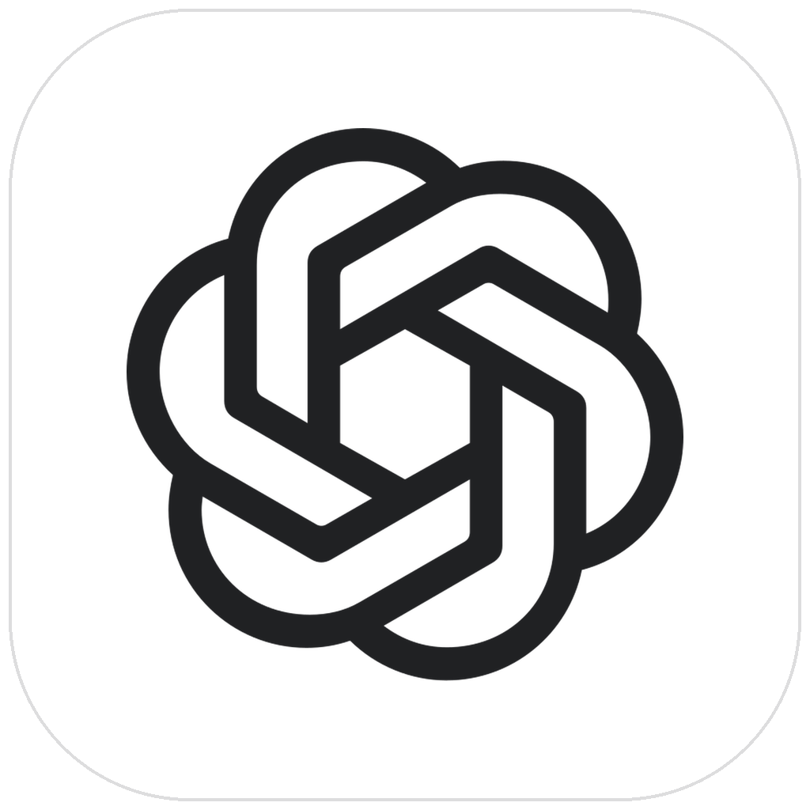
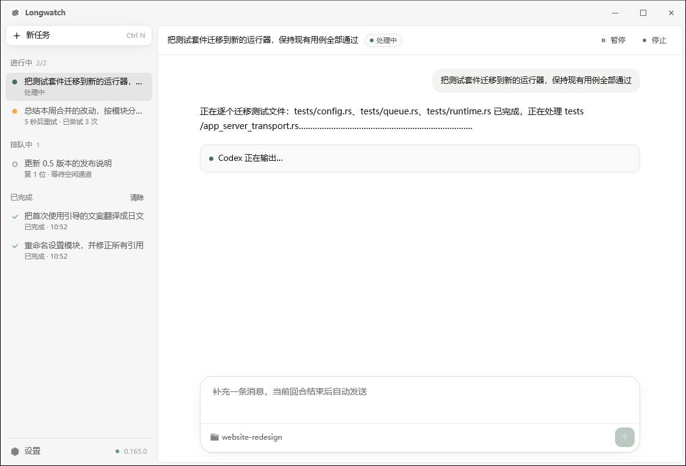

<p align="center">
  
</p>

<h1 align="center">Longwatch for Codex</h1>

<p align="center"><strong>Stay with the task.</strong></p>

<p align="center">
  A small native desktop app that queues your Codex tasks and carries each one through “high demand” errors, dropped connections, sleep, and restarts, then tells you the moment a real answer is ready.
</p>

<p align="center">
  <a href="https://github.com/wintopic/codex-longwatch/actions/workflows/ci.yml"></a>
  <a href="https://github.com/wintopic/codex-longwatch/releases"></a>
  <a href="LICENSE"></a>
  
  
</p>

<p align="center">
  <a href="README.zh-CN.md">简体中文</a> ·
  <a href="#quick-start">Quick start</a> ·
  <a href="#using-longwatch">Usage</a> ·
  <a href="#how-it-works">How it works</a> ·
  <a href="#faq">FAQ</a>
</p>



## Why Longwatch

When Codex is busy it replies with “We're currently experiencing high demand…”. Streams also get cut, and laptops go to sleep halfway through a job. Babysitting a long task means watching for the error and pressing send again. Pressing send blindly is worse: if the first request *did* arrive, the same work now runs twice.

Longwatch does the waiting for you. You describe a task once. Longwatch sends it through your own Codex CLI and tells busy and transient failures apart from real answers. It waits a sensible amount of time and tries again, and it never has two requests in flight for the same conversation. When a valid reply arrives, a notification with a **查看** (View) button takes you straight to it.

It is not a way around limits. It adds no filler prompts, rotates no accounts, and never runs parallel retries of the same task.

## Highlights

- **Queue-first workbench.** The sidebar *is* the queue: running, retrying with a live countdown, waiting by position, finished. The main pane shows one task's conversation, and you can keep chatting there.
- **The same requests as the official app.** Longwatch drives the same local `codex app-server` that the official Codex desktop app uses, and introduces itself the same way. Upstream requests therefore carry `originator: Codex Desktop` and the same User-Agent. You can change this under [Request identity](#request-identity).
- **Never submits twice.** Each conversation has at most one active turn. A write-ahead marker is saved before every send, and after a crash or restart Longwatch reconciles by `clientUserMessageId`.
- **Patient, Codex-aware retries.** Peak-load notices re-queue about every 10 seconds. Other transient failures back off from 30 seconds to 10 minutes. Authentication, quota and policy errors pause and wait for you.
- **Sleep-safe.** After the machine wakes, Longwatch waits at least 60 seconds and never fires a burst of missed retries.
- **Several tasks at once, if you want.** Run 1–8 independent conversations side by side; the rest wait in first-in, first-out order.
- **Hard to miss when it's done.** On Windows, an alarm-style notification keeps ringing until you click **查看**. macOS and Linux use native notifications with the same action.
- **Native and local.** Built with Rust and GPUI. There is no WebView, no local HTTP server and no telemetry. Builds are available for Windows, macOS (Intel and Apple Silicon) and Linux.

## Quick start

**1. Install and sign in to the Codex CLI.** Longwatch drives your own Codex CLI and reuses its sign-in and provider settings:

```bash
npm install -g @openai/codex
```

```bash
codex login
```

Check that `codex --version` works in a normal terminal. A recent release is recommended; Longwatch is developed and tested against Codex CLI 0.165.

**2. Install Longwatch** from [GitHub Releases](https://github.com/wintopic/codex-longwatch/releases/latest):

| Platform | Download |
| --- | --- |
| Windows 10 1809+ (x64) | `Longwatch-<version>-windows-x64-setup.exe` (installer) or `Longwatch-<version>-windows-x64.zip` (portable) |
| macOS 12+ | `Longwatch-<version>-macos-arm64.dmg` (Apple Silicon) or `…-macos-x64.dmg` (Intel); portable `.app.tar.gz` |
| Linux x64 | `.deb`, `.AppImage`, or portable `.tar.gz` |

Each platform also has a `SHA256SUMS-*.txt` checksum file. The builds are not code-signed yet, so Windows SmartScreen or macOS Gatekeeper may warn the first time you open them.

**3. Queue your first task.** Click **新任务** (New task) or press `Ctrl+N`. Describe the task, optionally choose a working folder with the folder button under the text box, and press `Enter`. You can then close the window; on Windows it keeps running in the tray, and a notification arrives when the answer is ready.

## Using Longwatch

The interface is in Simplified Chinese. English names are given in parentheses below.

### The queue

| Sidebar group | What it shows |
| --- | --- |
| **进行中** (Running) `n/max` | Tasks with a live Codex conversation, either **处理中** (working) or a countdown such as `5 秒后重试 · 已尝试 3 次` (retry in 5 s · 3 attempts so far). |
| **排队中** (Queued) | Tasks waiting for a free lane, in submission order, e.g. `第 1 位 · 等待空闲通道` (position 1 · waiting for a free lane). |
| **已完成** (Finished) | Completed, stopped and failed tasks. **清除** (Clear) removes the finished ones. |

The dot beside **设置** (Settings) at the bottom of the sidebar shows the Codex CLI version Longwatch found.

### Task actions

| To | Do this |
| --- | --- |
| Add a task | **新任务** (`Ctrl+N`), type, press `Enter`. `Shift+Enter` inserts a line break. |
| Choose the working folder | Click the folder button under the text box (**默认目录**, “default folder”, until you pick one). |
| Follow up | Select the task and type. While a turn is still running, the message is held and sent when the turn ends; **撤回** (Withdraw) takes it back. |
| Pause and resume | **暂停** (Pause) interrupts the current turn and keeps the conversation. **继续** (Continue) asks Codex to carry on where it stopped. |
| Stop | **停止** (Stop) ends the current turn but keeps the conversation, so your next message continues it. |
| Skip the wait | **立即重试** (Retry now) on a task that is waiting to retry. |
| Leave the queue | **取消排队** (Cancel) on a queued task. |
| Open the result | **在 Codex 中打开** (Open in Codex), or **查看** (View) on the completion notification. |
| Delete a task | **移除** (Remove) on a task that is no longer running. |

Results open through a `codex://threads/<id>` link, which shows the conversation in the Codex desktop app. If nothing handles that link, Longwatch runs `codex resume <id>` instead.

On Windows, closing the window hides Longwatch to the tray. Quitting asks for confirmation while tasks are running or queued, because they stop and do not resume by themselves.

### When a task finishes

- **完成提示音** (Completion sound) on, the default: Windows shows an alarm-style notification with a looping sound. It stays on screen until you click **查看** (View), which opens the conversation and silences it, or until you close the notification.
- Sound off: a normal, quiet notification. Click it to open the result.
- macOS and Linux show a native notification with the same **查看** action.

### Settings

| Section | Setting | Default | What it does |
| --- | --- | --- | --- |
| 队列 (Queue) | 同时运行 (Run at once) | 1 | How many tasks may run at the same time (1–8). The rest wait in order. Each running task uses its own `codex app-server` process, so start with 2 and raise it only if your machine and Codex limits allow. |
| | 繁忙提示短语 (Busy phrases) | Codex's peak-load messages | A reply that starts with one of these phrases is treated as “busy, try again” rather than an answer. Separate phrases with `\|`. |
| 启动 (Startup) | 启动时自动发送 (Send on launch) | Off | Queue the default message as a new task each time Longwatch opens. When off, the message only pre-fills the text box. |
| | 默认消息 (Default message) | Empty | The message used by the option above. |
| 连接 (Connection) | 请求身份 (Request identity) | 官方桌面版 (Official desktop) | How Longwatch introduces itself to Codex; see below. Takes effect from the next connection. |
| | Codex 程序 (Codex program) | `codex` on `PATH` | Shows the detected version and path. To use a different executable, set `codexPath` in `config.json`. |
| 提醒 (Alerts) | 完成提示音 (Completion sound) | On | The alarm-style completion notification described above. |
| 诊断 (Diagnostics) | 诊断信息 (Diagnostics) | — | **复制诊断** (Copy diagnostics) copies a support report without task text or credentials. **打开日志** (Open logs) opens the log folder. |

#### Request identity

| Option | `clientInfo.name` sent to app-server | `originator` seen upstream |
| --- | --- | --- |
| **官方桌面版** (Official desktop, default) | `codex_desktop` | `Codex Desktop` |
| **官方 CLI** (Official CLI) | `codex_cli_rs` | `codex_cli_rs` |
| **Longwatch** | `codex-longwatch` | `codex-longwatch` |

The official desktop app starts app-server with `CODEX_INTERNAL_ORIGINATOR_OVERRIDE=Codex Desktop` and sends `clientInfo { name: "codex_desktop", title: "Codex Desktop" }`. Longwatch does exactly the same for the default option. The other two options remove any inherited override, so they can never claim the desktop identity by accident.

#### Advanced settings in `config.json`

These have no switch in the window. Edit them while Longwatch is closed.

| Key | Default | Meaning |
| --- | --- | --- |
| `retryPolicy.baseDelaySecs` | `30` | First backoff delay for ordinary transient failures (minimum 15). |
| `retryPolicy.multiplier` | `1.7` | Growth factor between attempts. |
| `retryPolicy.maxDelaySecs` | `600` | Longest backoff delay. |
| `retryPolicy.jitterRatio` | `0.15` | Random spread of ± this fraction (0–0.5). |
| `retryPolicy.highDemandDelaySecs` | `10` | Re-queue interval after a peak-load notice (1–300). |
| `retryPolicy.wakeDelaySecs` | `60` | Minimum wait after the system wakes (minimum 60). |
| `retryPolicy.maxEmptyReplies` | `5` | Empty “successful” replies tolerated before pausing. |
| `turnTimeoutSecs` | `1800` | A turn that runs longer than this is interrupted and retried (minimum 60). |
| `codexPath` | `"codex"` | Codex CLI executable. |

## How it works

### One task, one state machine

```text
Idle
  └─ start ─> Connecting ─> Sending ─> Waiting
                 ▲             │           │
                 │             │           ├─ valid final reply ─> Success
                 │             │           ├─ retryable outcome ─> Backoff ─┐
                 │             │           └─ needs the user ────> Paused / FatalError
                 └─────────────┴──────────────────────────────────────────────┘
```

Each task runs in its own worker, and one Tokio task serialises every transition. `QueueMachine::begin_sending` refuses a new send while a turn is active, and late events from older turns are ignored. With concurrency above 1, a scheduler hands queued tasks to free lanes in FIFO order; each lane has its own app-server process, thread and recovery state.

### Talking to Codex

Longwatch starts the official Codex CLI as `codex app-server --listen stdio://` and speaks newline-delimited JSON-RPC to it, with the same messages the official desktop app uses:

```text
initialize                 clientInfo + capabilities (experimentalApi, notification opt-outs)
thread/start               threadSource "user"
thread/resume              excludeTurns + initialTurnsPage (only the latest turn)
turn/start                 text input tagged with a clientUserMessageId
item/agentMessage/delta    streaming preview
item/completed             authoritative message item
turn/completed             the point where the outcome is decided
thread/items/list          re-reads a final reply missed while disconnected
turn/interrupt             pause, stop, or timeout
```

Interactive server requests, such as approvals for commands or file changes, extra permissions, tool input and MCP elicitation, receive the same **decline** the official clients send. Longwatch never approves anything on your behalf; Codex sees an ordinary refusal and carries on.

Payloads are decoded tolerantly as `serde_json::Value`, so neighbouring Codex CLI versions keep working without Longwatch depending on every optional field.

### Never sending the same task twice

The risky moment is between sending `turn/start` and receiving its acknowledgement. If the process dies in that gap, the client cannot know whether Codex accepted the turn. Longwatch handles it with a small write-ahead protocol:

1. Record the attempt locally.
2. Atomically save `submissionUncertain = true` together with a fresh `clientUserMessageId`.
3. Only then call `turn/start`, tagged with that ID.
4. Clear the marker once a turn ID is acknowledged or the thread has been reconciled.
5. After a restart, call `thread/resume` before anything else is sent.
6. If the latest turn carries our `clientUserMessageId`, adopt its real state. If it carries a different one, the request never arrived and is sent again, rather than mistaking an older answer for this one.
7. If the outcome still cannot be proven, wait in a normal backoff instead of resending at once.

If that critical state cannot be written to disk, Longwatch pauses **before** the request leaves the process.

### Retry decisions

| Outcome | What Longwatch does |
| --- | --- |
| Codex reports `willRetry = true` | Leaves the turn to Codex's own retry; sends nothing extra |
| Peak-load (“high demand”) notice | Re-queues every ~10 s, without a red retry alert |
| Codex's internal retries exhausted | Starts the next outer attempt after a short settling delay |
| HTTP 429 / 502 / 503 / 504, overload text, lost process or stream | Backs off conservatively and retries |
| Successful but empty reply | Retries up to `maxEmptyReplies` times |
| Authentication, quota, policy, or configuration error | Pauses for you |
| Broken protocol invariant | Stops with `FatalError` |

Ordinary transient failures use:

```text
delay(n) = min(30 s × 1.7^(n-1), 10 min) × random(0.85 … 1.15), never below 15 s
```

Peak-load notices use a fixed, human-like cadence instead:

```text
delay = 10 s × random(0.8 … 1.2)
```

Codex already retries capacity errors internally (five reconnects about 10–12 seconds apart). The outer queue keeps that rhythm, so after Codex gives up it re-queues roughly every ten seconds, much like a person pressing send again after reading the error, and never in a tight loop. If the app-server process itself drops, reconnects wait 5 s, then 15 s, then 60 s.

### What is stored, and where

Settings and recovery state are JSON files in the operating system's standard configuration folder, each replaced atomically through a temporary file:

| File | Contents |
| --- | --- |
| `config.json` | Your settings, including the current task text so it can continue after a restart |
| `scheduler.json` | The waiting queue and which task is selected |
| `sessions/<id>/` | Per-task settings and recovery state: thread and turn IDs, phase, counters, next retry time, a SHA-256 digest of the task text, and at most 4,000 characters of reply preview |
| `logs/`, `crash-reports/` | Daily logs and crash reports |

Typical locations are `%APPDATA%\Longwatch\config` on Windows, `~/Library/Application Support/Longwatch` on macOS and `~/.config/longwatch` on Linux. Streaming text stays in memory; only final results and safety-critical boundaries are written. Damaged or newer-version files are moved aside as `*.corrupt-<timestamp>` and safe defaults are loaded. Data from older Longwatch or CodexQueue installations is migrated automatically.

## Privacy and safety

- Everything runs on your computer. Longwatch talks only to the locally installed Codex CLI, which talks to your configured provider.
- It reuses your existing `CODEX_HOME`, provider settings and Codex sign-in. It never reads, asks for or stores API keys.
- By default, requests identify as the official Codex desktop app. Choose **Longwatch** under 设置 → 连接 → 请求身份 if you would rather have them attributed to Longwatch.
- It contains no WebView, no Node runtime, no local HTTP server, no remote control, no telemetry and no account switching.
- The diagnostics report excludes task text, configuration files, environment variables and credentials. It can include app and system versions, queue metadata, the thread ID, a short reply or error preview and recent Longwatch logs.

`config.json` and the logs can contain your task text, working folder and other details. Review them before sharing them publicly.

## FAQ

**Will Longwatch ever run the same task twice?**\
No. Each conversation has at most one active turn, and the [write-ahead protocol](#never-sending-the-same-task-twice) checks with Codex after any crash before it sends again.

**Does it get around rate limits or quotas?**\
No. It waits and retries on a conservative schedule. Quota, authentication and policy errors pause the task until you deal with them.

**How do I silence the completion alarm?**\
Click **查看** (View) or close the notification. To get quiet notifications instead, turn off **完成提示音** in Settings.

**Can I keep using Codex while Longwatch is waiting?**\
Yes. Longwatch runs its own app-server process per task and doesn't touch other Codex windows. **查看** and **在 Codex 中打开** open the same conversation in the Codex desktop app.

**What happens if my computer sleeps or Longwatch crashes?**\
After waking, Longwatch waits at least 60 seconds before the next attempt. Before it sends anything in a saved conversation again, it resumes the thread and checks with Codex what actually happened. Quitting Longwatch on purpose stops the queue; those tasks do not restart by themselves.

**Why does it identify as the official desktop app?**\
So that its requests are the same as the ones you would send by hand in the official app. If you prefer, switch to **Longwatch** and the `originator` will say `codex-longwatch`.

## Troubleshooting

**“未找到 Codex” (Codex not found)**\
Run `codex --version` in a normal terminal, then check 设置 → 连接 → Codex 程序. Longwatch inherits the environment of whatever starts it, so a `codex` that only exists in one shell's `PATH` may be invisible to it. Set `codexPath` in `config.json` to point at a specific executable.

**Keeps reconnecting**\
Open 设置 → 诊断 → 打开日志 and read the newest `longwatch.log.*`. It records app-server stderr and the connection and retry timeline.

**State-save warning**\
Check disk space, folder permissions and security software. Ordinary save failures keep the task running in memory; a failure right before a submission pauses the queue so nothing can be sent twice.

**Damaged configuration**\
Longwatch renames the invalid file to `.corrupt-<timestamp>` and starts with safe defaults.

**Reporting a bug**\
Use **复制诊断** (Copy diagnostics) and paste the report into a [GitHub issue](https://github.com/wintopic/codex-longwatch/issues). Report security problems privately, as described in [SECURITY.md](SECURITY.md).

## Build from source

Install Rust 1.85 or newer and GPUI's native dependencies, then:

```bash
git clone https://github.com/wintopic/codex-longwatch.git
```

```bash
cd codex-longwatch && cargo build --locked --release --all-features
```

The binary is `target/release/codex-longwatch` (`.exe` on Windows). Linux additionally needs Fontconfig, X11/XCB, Wayland, EGL and OpenGL development packages; the CI workflow lists the exact Ubuntu packages.

To build the Windows portable ZIP and installer locally (requires [Inno Setup 6](https://jrsoftware.org/isinfo.php)):

```bash
powershell -File packaging/windows/build-portable.ps1 -IsccPath "<path to ISCC.exe>"
```

## Development

```bash
cargo fmt --all -- --check
cargo clippy --locked --all-targets --all-features -- -D warnings
cargo test --locked --all-features --all
```

The test suite ships a fake app-server and covers persistent resume, authoritative completed items, peak-load retry paths, internal-retry ownership, process crashes, interrupts, uncertain-submission reconciliation and the official handshake. `tests/real_codex.rs` is an opt-in round trip against a real `codex app-server`; point it at a throwaway `CODEX_HOME`, never a real account. CI runs on Windows, Linux, macOS Intel and macOS Apple Silicon, and pushing a `v*` tag publishes installers, portable archives and checksums for every platform.

### Project layout

```text
GPUI desktop shell (src/ui.rs)
        │ commands + snapshots
        ▼
Multi-session scheduler ── FIFO waiting queue
        │ 1–8 independent lanes
        ├── QueueRuntime ── QueueMachine ── classifier / backoff / wake detector
        │         └── codex app-server process ── conversation 1
        └── QueueRuntime ── QueueMachine
                  └── codex app-server process ── conversation N
```

| Path | Responsibility |
| --- | --- |
| `src/runtime.rs` | Multi-session scheduling, serialised workers, recovery protocol, deadlines, persistence boundaries |
| `src/queue.rs` | Deterministic queue state machine and its invariants |
| `src/app_server.rs` | Codex app-server lifecycle, handshake and JSON-RPC transport |
| `src/classifier.rs` | Success, retry and pause classification |
| `src/backoff.rs` | Backoff, jitter, attempt ledger and wake detection |
| `src/config.rs` | Versioned config and state documents, migration, atomic writes |
| `src/ui.rs` | The GPUI interface |
| `crates/gpui_platform` | Notifications, tray, opening results, alerts and other OS integration |

See [CONTRIBUTING.md](CONTRIBUTING.md) before opening a pull request.

## Project status

Longwatch is an early-stage community project. The app-server protocol can change between Codex CLI releases, and the release builds are not yet signed or notarized. Read the release notes before upgrading, and keep backups of important work.

## Name and trademark notice

Longwatch for Codex is an independent, unofficial open-source project. It is not affiliated with, endorsed by, sponsored by, or supported by OpenAI. Codex, ChatGPT, OpenAI, and related names and marks are trademarks of their respective owners. The bundled mark only indicates compatibility and does not imply official status.

## License

Licensed under the [Apache License 2.0](LICENSE).

## Acknowledgements

- Built with [GPUI](https://crates.io/crates/gpui) and [TDesign-GPUI](https://github.com/wintopic/TDesign-GPUI).
- The deep-link, GUI-input and session-observation ideas were informed by [CodexPanel](https://github.com/wintopic/CodexPanel). Longwatch is an independent implementation and contains none of its non-commercially licensed source code.
