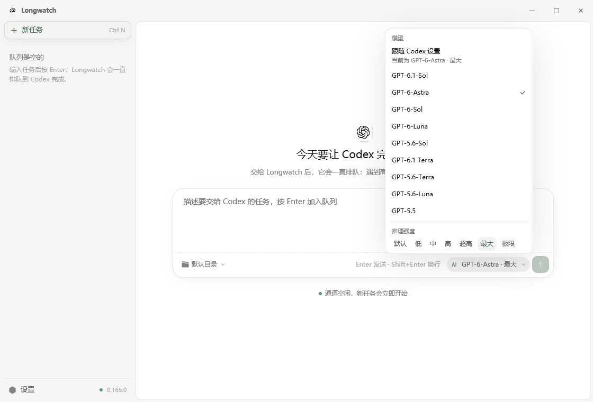

<p align="center">
  
</p>

<h1 align="center">Longwatch for Codex</h1>

<p align="center"><strong>Stay with the task.</strong></p>

<p align="center">
  一个小巧的原生桌面应用：把 Codex 任务排进队列，替你扛过“高需求”报错、断线、休眠与重启，拿到真正的回答后第一时间提醒你。
</p>

<p align="center">
  <a href="https://github.com/wintopic/codex-longwatch/actions/workflows/ci.yml"></a>
  <a href="https://github.com/wintopic/codex-longwatch/releases"></a>
  <a href="LICENSE"></a>
  
  
</p>

<p align="center">
  <a href="README.md">English</a> ·
  <a href="#快速开始">快速开始</a> ·
  <a href="#使用方法">使用方法</a> ·
  <a href="#实现原理">实现原理</a> ·
  <a href="#常见问题">常见问题</a>
</p>


## 为什么做 Longwatch

Codex 繁忙时会回复“We're currently experiencing high demand…”；事件流也可能中途断开，笔记本还会在任务跑到一半时休眠。盯着一个长任务，就得一直守着报错、手动再点发送。可是盲目重发更糟：如果第一次请求其实已经送达，同一份工作就会被执行两遍。

Longwatch 替你守着。你只需描述一次任务，它会通过你自己的 Codex CLI 发出请求，分清“繁忙或瞬时故障”和“真正的回答”，失败后立即再试，而且同一个会话里绝不会同时有两个请求。收到有效回复后，带「查看」按钮的通知会直接带你回到结果。

它不是绕过限制的工具：不会生成凑数提示词，不会切换账号，也不会对同一个任务并发重试。

## 核心能力

- **以排队为中心的工作台。** 侧栏就是队列：进行中、带倒计时的等待重试、按顺位排队、已完成。右侧显示选中任务的对话，可以直接在里面继续追问。
- **与官方应用相同的请求。** Longwatch 驱动的是官方 Codex 桌面应用同样使用的本地 `codex app-server`，并以相同方式表明身份，因此上游请求带有 `originator: Codex Desktop` 和相同的 User-Agent。可以在[请求身份](#请求身份)中切换。
- **绝不重复提交。** 每个会话同一时间最多一个活动回合；每次发送前先预写标记，崩溃或重启后按 `clientUserMessageId` 与 Codex 对账。
- **理解 Codex 的立即重试。** 失败后马上重新发送，不再逐次加长等待；同一个任务的两次尝试只保持至少 2 秒间隔。鉴权、额度、策略类错误会暂停并等你处理。
- **可以选择模型。** 输入框里的模型按钮列出 Codex 提供的模型及各自的推理强度；默认跟随你的 Codex `config.toml`。
- **休眠唤醒保护。** 系统唤醒后至少再等 60 秒，绝不把错过的重试一次性补发。
- **需要时可以并行。** 可同时运行 1–8 个互相独立的会话，其余任务按先来后到排队。
- **完成提醒不会错过。** Windows 上是闹钟式通知，会一直响到你点「查看」；macOS 与 Linux 使用带同样按钮的系统通知。
- **原生、本地。** 基于 Rust 与 GPUI，不含 WebView、本地 HTTP 服务或遥测。提供 Windows、macOS（Intel 与 Apple Silicon）和 Linux 版本。

## 快速开始

**1. 安装并登录 Codex CLI。** Longwatch 驱动的是你自己的 Codex CLI，沿用它的登录状态与供应商配置：

```bash
npm install -g @openai/codex
```

```bash
codex login
```

确认在普通终端里能运行 `codex --version`。建议使用较新的版本；Longwatch 基于 Codex CLI 0.165 开发与测试。

**2. 安装 Longwatch。** 前往 [GitHub Releases](https://github.com/wintopic/codex-longwatch/releases/latest) 下载：

| 平台 | 下载 |
| --- | --- |
| Windows 10 1809+（x64） | `Longwatch-<版本>-windows-x64-setup.exe`（安装程序）或 `Longwatch-<版本>-windows-x64.zip`（便携版） |
| macOS 12+ | Apple Silicon 选 `Longwatch-<版本>-macos-arm64.dmg`，Intel 选 `…-macos-x64.dmg`；另有便携 `.app.tar.gz` |
| Linux x64 | `.deb`、`.AppImage` 或便携 `.tar.gz` |

每个平台都附带 `SHA256SUMS-*.txt` 校验文件。目前的构建尚未代码签名，首次打开时 Windows SmartScreen 或 macOS Gatekeeper 可能会提示。

**3. 排上第一个任务。** 点击「新任务」或按 `Ctrl+N`，写下任务，需要时用输入框下方的文件夹按钮选择工作目录，然后按 `Enter`。之后可以直接关掉窗口：Windows 上它会留在托盘继续工作，有结果时会弹出通知。

## 使用方法

### 队列

| 侧栏分组 | 含义 |
| --- | --- |
| **进行中** `n/max` | 正在与 Codex 对话的任务，显示“处理中”或重试提示，例如 `1 秒后重试 · 已尝试 8 次`。 |
| **排队中** | 等待空闲通道的任务，按提交顺序排列，例如 `第 1 位 · 等待空闲通道`。 |
| **已完成** | 已完成、已停止或失败的任务。点「清除」可移除已完成的任务。 |

侧栏底部「设置」旁的圆点显示 Longwatch 检测到的 Codex CLI 版本。

### 任务操作

| 想要 | 这样做 |
| --- | --- |
| 新建任务 | 点「新任务」（`Ctrl+N`），输入后按 `Enter`；`Shift+Enter` 换行。 |
| 选择工作目录 | 点输入框下方的文件夹按钮（未选择时显示“默认目录”）。 |
| 选择模型 | 点输入框右侧的模型按钮，详见[选择模型](#选择模型)。 |
| 追问 | 选中任务后直接输入。回合仍在进行时，消息会先暂存，当前回合结束后自动发送；点「撤回」可以收回。 |
| 暂停与继续 | 「暂停」中断当前回合并保留会话；「继续」让 Codex 从中断处接着做。 |
| 停止 | 「停止」结束当前回合但保留会话，下一条消息会接着这个会话。 |
| 不想等了 | 对正在等待重试的任务点「立即重试」。 |
| 退出队列 | 对排队中的任务点「取消排队」。 |
| 查看结果 | 点「在 Codex 中打开」，或点完成通知上的「查看」。 |
| 删除任务 | 对不在运行的任务点「移除」。 |

打开结果时使用 `codex://threads/<id>` 链接，在 Codex 桌面应用里显示该会话；如果没有程序处理这个链接，Longwatch 会改为运行 `codex resume <id>`。

### 选择模型

模型按钮在输入框右侧、发送按钮旁边。菜单里列出你的 Codex CLI 提供的模型（官方的 `model/list`），下面是所选模型的推理强度。



- **跟随 Codex 设置** 是默认选项。此时 Longwatch 完全不发送模型，Codex 使用它自己 `config.toml` 里的 `model` 和 `model_reasoning_effort`。菜单会显示当前实际是哪个模型，按钮显示为 `默认 · <模型>`。
- 选定一个模型后，这个任务的每个回合都会带上它。推理强度默认是「默认」，即交给 Codex 决定（你配置的强度，或模型自己的默认值）；也可以选 低 / 中 / 高 / 超高 / 最大 / 极限。
- 选择作用于新任务，并会被记住。追问沿用原会话的模型，按钮只显示、不可更改。

在 Windows 上关闭窗口只会隐藏到托盘。有任务正在进行或排队时，退出前会再确认一次：退出后这些任务会停止，不会自动恢复。

### 任务完成时

- 开启「完成提示音」（默认）：Windows 弹出闹钟式通知并循环响铃，一直停留到你点「查看」（打开对话并停止响铃）或关闭通知为止。
- 关闭提示音：弹出普通的静音通知，点击即可打开结果。
- macOS 与 Linux 显示带「查看」按钮的系统通知。

### 设置

| 分组 | 选项 | 默认值 | 作用 |
| --- | --- | --- | --- |
| 队列 | 同时运行 | 1 | 最多同时进行的任务数（1–8），其余任务按顺序排队。每个运行中的任务都会占用一个独立的 `codex app-server` 进程，建议从 2 开始，按机器性能和 Codex 额度逐步调高。 |
| | 繁忙提示短语 | Codex 的高峰繁忙提示 | Codex 的回复以这些短语开头时，视为“繁忙，请重试”而不是回答。多个短语用 `\|` 分隔。 |
| 启动 | 启动时自动发送 | 关 | 每次打开 Longwatch 都把默认消息作为新任务加入队列；关闭时只用来预填输入框。 |
| | 默认消息 | 空 | 上一项使用的消息。 |
| 连接 | 请求身份 | 官方桌面版 | Longwatch 向 Codex 表明的身份，见下文；从下一次连接开始生效。 |
| | Codex 程序 | `PATH` 中的 `codex` | 显示检测到的版本与路径。要换用其它可执行文件，在 `config.json` 中设置 `codexPath`。 |
| 提醒 | 完成提示音 | 开 | 上文所述的闹钟式完成通知。 |
| 诊断 | 诊断信息 | — | 「复制诊断」复制一份不含任务原文与凭据的支持报告；「打开日志」打开日志目录。 |

#### 请求身份

| 选项 | 发给 app-server 的 `clientInfo.name` | 上游看到的 `originator` |
| --- | --- | --- |
| **官方桌面版**（默认） | `codex_desktop` | `Codex Desktop` |
| **官方 CLI** | `codex_cli_rs` | `codex_cli_rs` |
| **Longwatch** | `codex-longwatch` | `codex-longwatch` |

官方桌面应用以 `CODEX_INTERNAL_ORIGINATOR_OVERRIDE=Codex Desktop` 启动 app-server，并发送 `clientInfo { name: "codex_desktop", title: "Codex Desktop" }`；选择默认选项时，Longwatch 的做法完全相同。另外两个选项会清除继承来的覆盖变量，因此绝不会意外冒用桌面版身份。

#### `config.json` 中的高级设置

这些选项没有界面开关，请在 Longwatch 关闭时编辑。

| 键 | 默认值 | 含义 |
| --- | --- | --- |
| `defaultModel` | `null` | 新任务使用的模型，由模型按钮设置；`null` 表示跟随 Codex 配置。 |
| `defaultReasoningEffort` | `null` | 新任务的推理强度；`null` 表示交给 Codex 决定。 |
| `retryPolicy.wakeDelaySecs` | `60` | 系统唤醒后的最短等待（不少于 60）。 |
| `retryPolicy.maxEmptyReplies` | `5` | 连续收到多少次“成功但为空”的回复后暂停。 |
| `turnTimeoutSecs` | `1800` | 单个回合超过这个时长会被中断并重试（不少于 60）。 |
| `codexPath` | `"codex"` | Codex CLI 可执行文件。 |

## 实现原理

### 一个任务，一个状态机

```text
Idle
  └─ 开始 ─> Connecting ─> Sending ─> Waiting
                 ▲             │           │
                 │             │           ├─ 有效最终回复 ─> Success
                 │             │           ├─ 可重试结果 ──> Backoff ─┐
                 │             │           └─ 需要人工处理 ─> Paused / FatalError
                 └─────────────┴──────────────────────────────────────┘
```

每个任务都在自己的 worker 中运行，所有状态变化由一个 Tokio 任务串行处理。`QueueMachine::begin_sending` 在存在活动回合时直接拒绝新的发送，迟到的旧回合事件也会被忽略。并发数大于 1 时，调度器按先来后到把排队任务分配给空闲通道；每个通道都有自己的 app-server 进程、线程与恢复状态。

### 与 Codex 的通信

Longwatch 以 `codex app-server --listen stdio://` 启动官方 Codex CLI，通过按行分隔的 JSON-RPC 通信，使用的消息与官方桌面应用一致：

```text
initialize                 clientInfo + capabilities（experimentalApi、通知退订）
thread/start               threadSource "user"
thread/resume              excludeTurns + initialTurnsPage（只取最近一个回合）
turn/start                 文本输入，附带 clientUserMessageId；选了模型时带上 model 和 effort
model/list                 模型菜单里的模型（读取所有分页）
config/read                你的 Codex 配置选定的模型和推理强度
item/agentMessage/delta    流式预览
item/completed             权威消息项
turn/completed             判定结果的时刻
thread/items/list          断线期间错过最终回复时回读
turn/interrupt             暂停、停止或超时中断
```

启动时一旦找到 Codex CLI，Longwatch 会临时启动一个 app-server，只为发送 `model/list` 和 `config/read`；官方应用的模型选择器发的也是这两个请求。

需要人工处理的服务端请求（执行命令或修改文件的审批、额外权限、工具补充信息、MCP 表单）会收到与官方客户端相同的“拒绝”答复。Longwatch 从不替你批准任何操作；Codex 只会看到一次普通的拒绝，然后继续工作。

协议载荷以宽容的 `serde_json::Value` 解码，不强依赖每个可选字段，相邻版本的 Codex CLI 也能继续使用。

### 如何绝不重复发送

最危险的时刻位于发出 `turn/start` 与收到确认之间。如果进程恰好在这个间隙崩溃，客户端无法知道 Codex 是否已经接受了这个回合。Longwatch 用一套很小的预写式协议解决：

1. 在本地记录这次尝试。
2. 原子保存 `submissionUncertain = true`，连同一个新的 `clientUserMessageId`。
3. 保存成功后才调用 `turn/start`，并附带这个 ID。
4. 收到回合 ID 或完成线程对账后清除标记。
5. 重启后先调用 `thread/resume`，在此之前不发送任何内容。
6. 如果最近一个回合带着我们的 `clientUserMessageId`，就以它的真实状态为准；如果带的是别的 ID，说明上次请求根本没有送达，于是重新发送，而不会把更早的回答误当成这次的结果。
7. 如果仍然无法确认结果，请求会回到正常的重试流程：下一次尝试会先恢复线程、再核对一次，而不是当场重发。

如果这些关键状态无法写入磁盘，Longwatch 会在请求离开进程**之前**暂停。

### 重试判定

| 结果 | Longwatch 的处理 |
| --- | --- |
| Codex 报告 `willRetry = true` | 交给 Codex 自己重试，不额外发送 |
| 高峰繁忙（“high demand”）提示 | 立即重新发送，不触发重试提醒 |
| Codex 内部重试已耗尽 | 立即重新发送 |
| HTTP 429 / 502 / 503 / 504、过载文本、进程或事件流中断 | 立即重新发送；app-server 断开时立即重启 |
| 成功但回复为空 | 立即重新发送，最多 `maxEmptyReplies` 次 |
| 鉴权、额度、策略或配置错误 | 暂停，等你处理 |
| 协议不变量被破坏 | 以 `FatalError` 停止 |

不再有逐次加长的退避：一旦确认失败就立即重新发送。唯一的规则是，同一个任务的两次尝试至少间隔 2 秒，这样即使请求一发出就失败，也不会变成高速死循环。Codex 自己对容量错误做内部重试时（约 5 次重连，间隔 10–12 秒），Longwatch 不插手，等 Codex 放弃的那一刻立即重新发送。

唯一更长的等待是电脑从休眠中唤醒之后：至少 60 秒，让网络先恢复。

### 存了什么、存在哪里

设置与恢复状态以 JSON 文件保存在系统标准配置目录中，每次都先写临时文件再原子替换：

| 文件 | 内容 |
| --- | --- |
| `config.json` | 你的设置，包括当前任务原文，便于重启后继续 |
| `scheduler.json` | 排队中的任务与当前选中的任务 |
| `sessions/<id>/` | 每个任务的设置与恢复状态：线程与回合 ID、阶段、计数器、下次重试时间、任务原文的 SHA-256 摘要，以及最多 4,000 字符的回复预览 |
| `logs/`、`crash-reports/` | 按日日志与崩溃报告 |

常见位置为 Windows 的 `%APPDATA%\Longwatch\config`、macOS 的 `~/Library/Application Support/Longwatch` 与 Linux 的 `~/.config/longwatch`。流式文本只保存在内存中，只有最终结果和安全关键的边界才会写盘。损坏或来自更新版本的文件会被改名为 `*.corrupt-<时间戳>` 移到一旁，随后加载安全默认值。旧版 Longwatch 或 CodexQueue 的数据会自动迁移。

## 隐私与安全

- 一切都在你的电脑上运行。Longwatch 只与本机安装的 Codex CLI 通信，再由 Codex CLI 连接你配置的服务商。
- 它沿用现有的 `CODEX_HOME`、服务商配置与 Codex 登录状态，从不读取、索要或保存 API key。
- 默认以官方 Codex 桌面应用的身份发出请求。如果希望请求标明来自 Longwatch，可在 设置 → 连接 → 请求身份 中选择“Longwatch”。
- 不含 WebView、Node 运行时、本地 HTTP 服务、远程控制、遥测或账号切换功能。
- 诊断报告不包含任务原文、配置文件、环境变量和凭据，但可能包含应用与系统版本、队列元数据、线程 ID、简短的回复或错误预览，以及近期的 Longwatch 日志。

`config.json` 和日志中可能有任务原文、工作目录等细节，公开分享前请先检查。

## 常见问题

**Longwatch 会把同一个任务执行两次吗？**\
不会。每个会话同一时间最多一个活动回合；任何崩溃之后，[预写式协议](#如何绝不重复发送)都会先向 Codex 核对，才可能再次发送。

**它能绕过速率限制或额度吗？**\
不能。它会立即重新发送，但同一个任务的两次尝试至少间隔 2 秒；遇到额度、鉴权、策略类错误时会暂停，等你处理。

**任务使用哪个模型？**\
添加任务时模型按钮上显示的那个。默认是「跟随 Codex 设置」：Longwatch 不发送模型，由 Codex 使用 `config.toml` 里的 `model` 和 `model_reasoning_effort`。追问沿用原会话的模型。

**怎样让完成提醒停止响铃？**\
点「查看」或关闭通知即可。想要安静的通知，可在设置中关闭「完成提示音」。

**Longwatch 等待时，我还能继续用 Codex 吗？**\
可以。Longwatch 为每个任务启动独立的 app-server 进程，不会影响其它 Codex 窗口。「查看」与「在 Codex 中打开」会在 Codex 桌面应用中打开同一个会话。

**电脑休眠或 Longwatch 崩溃会怎样？**\
唤醒后，Longwatch 至少等待 60 秒才进行下一次尝试。在已保存的会话里再次发送任何内容之前，它都会先恢复线程，向 Codex 核实实际发生了什么。主动退出 Longwatch 会停止队列，这些任务不会自动重新开始。

**为什么默认使用官方桌面版的身份？**\
这样它发出的请求与你在官方应用里手动发送的完全一致。如果你更希望标明来源，切换为“Longwatch”后，`originator` 会显示为 `codex-longwatch`。

## 故障排查

**提示“未找到 Codex”**\
先在普通终端运行 `codex --version`，再查看 设置 → 连接 → Codex 程序。Longwatch 继承启动它的进程环境，只存在于某个 shell `PATH` 里的 `codex` 可能对它不可见；可以在 `config.json` 中用 `codexPath` 指定可执行文件。

**一直在重新连接**\
打开 设置 → 诊断 → 打开日志，查看最新的 `longwatch.log.*`，其中记录了 app-server 的 stderr 以及连接与重试时间线。

**状态保存失败**\
检查磁盘空间、目录权限和安全软件。普通的保存失败不会中断内存中的任务；如果失败发生在提交前的关键时刻，Longwatch 会暂停队列，确保不会重复发送。

**配置损坏**\
Longwatch 会把无效文件改名为 `.corrupt-<时间戳>`，并以安全默认值启动。

**反馈问题**\
点「复制诊断」，把报告贴到 [GitHub issue](https://github.com/wintopic/codex-longwatch/issues) 中。安全问题请按 [SECURITY.md](SECURITY.md) 私下报告。

## 从源码构建

安装 Rust 1.85 或更新版本以及 GPUI 所需的本地依赖，然后：

```bash
git clone https://github.com/wintopic/codex-longwatch.git
```

```bash
cd codex-longwatch && cargo build --locked --release --all-features
```

生成的程序位于 `target/release/codex-longwatch`（Windows 上为 `.exe`）。Linux 还需要 Fontconfig、X11/XCB、Wayland、EGL 与 OpenGL 开发包，具体的 Ubuntu 包列表见 CI 工作流。

在本地生成 Windows 便携 ZIP 和安装程序（需要 [Inno Setup 6](https://jrsoftware.org/isinfo.php)）：

```bash
powershell -File packaging/windows/build-portable.ps1 -IsccPath "<ISCC.exe 的路径>"
```

## 开发与验证

```bash
cargo fmt --all -- --check
cargo clippy --locked --all-targets --all-features -- -D warnings
cargo test --locked --all-features --all
```

测试套件自带一个假的 app-server，覆盖持久线程恢复、权威完成项、高峰重试、内部重试归属、进程崩溃、中断、不确定提交对账以及官方握手。`tests/real_codex.rs` 是可选的真实 `codex app-server` 往返测试，只能指向一次性的 `CODEX_HOME`，切勿使用真实账号。CI 覆盖 Windows、Linux、macOS Intel 与 Apple Silicon；推送 `v*` 标签后会自动为各平台发布安装包、便携包与校验文件。

### 项目结构

```text
GPUI 桌面界面（src/ui.rs）
        │ 命令 + 状态快照
        ▼
多会话调度器 ── FIFO 等待队列
        │ 1–8 个独立通道
        ├── QueueRuntime ── QueueMachine ── 结果分类 / 重试间隔 / 唤醒检测
        │         └── codex app-server 进程 ── 会话 1
        └── QueueRuntime ── QueueMachine
                  └── codex app-server 进程 ── 会话 N
```

| 路径 | 职责 |
| --- | --- |
| `src/runtime.rs` | 多会话调度、串行 worker、恢复协议、超时与持久化边界 |
| `src/queue.rs` | 确定性的队列状态机及其不变量 |
| `src/app_server.rs` | Codex app-server 生命周期、握手与 JSON-RPC 传输 |
| `src/classifier.rs` | 成功、重试、暂停的结果分类 |
| `src/backoff.rs` | 重试间隔、尝试记录与唤醒检测 |
| `src/config.rs` | 版本化的配置与状态文件、迁移、原子写入 |
| `src/ui.rs` | GPUI 界面 |
| `crates/gpui_platform` | 通知、托盘、打开结果、提醒等系统集成 |

提交 Pull Request 前请先阅读 [CONTRIBUTING.md](CONTRIBUTING.md)。

## 项目状态

Longwatch 仍处于早期阶段。app-server 协议可能随 Codex CLI 版本变化，发布构建也尚未签名或公证。升级前请阅读发布说明，并为重要工作保留备份。

## 名称与商标声明

Longwatch for Codex 是独立、非官方的开源项目，与 OpenAI 不存在隶属、授权、赞助、背书或官方支持关系。Codex、ChatGPT、OpenAI 及相关名称和标志归各自权利人所有。仓库中的标志仅用于说明兼容性，不代表官方身份。

## 许可证

本项目采用 [Apache License 2.0](LICENSE)。

## 致谢

- 基于 [GPUI](https://crates.io/crates/gpui) 与 [TDesign-GPUI](https://github.com/wintopic/TDesign-GPUI) 构建。
- 深链、GUI 输入和会话观察的思路受到 [CodexPanel](https://github.com/wintopic/CodexPanel) 启发；Longwatch 为独立实现，不包含其非商业许可证约束下的源码。
